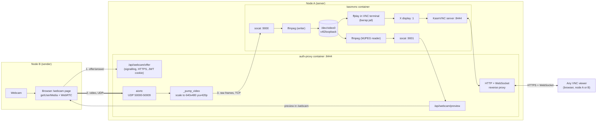
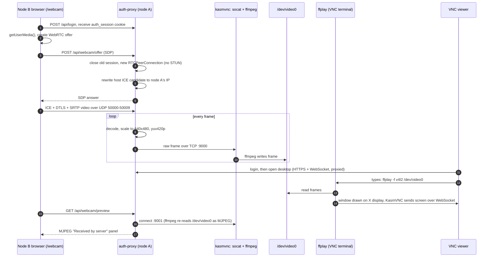

# Webcam-to-VNC: Architecture Diagrams

How a webcam on one machine (node B) ends up on the remote desktop hosted on another
(node A), and how anyone viewing that desktop can see it. The diagrams are Mermaid, so
they render on GitHub, in VS Code (Markdown preview with a Mermaid extension) and in most
Markdown viewers. Code references: `auth-proxy/app/webcam.py`, `auth-proxy/app/main.py`,
`start.sh`, `jailed-shell.sh`.

- [Flow chart: the path of one video frame](#flow-chart-the-path-of-one-video-frame)
- [Sequence diagram](#sequence-diagram)
- [How it works, step by step](#how-it-works-step-by-step)
- [Conditions and gotchas](#conditions-and-gotchas)

---

## Flow chart: the path of one video frame

---

## Sequence diagram

---

## How it works, step by step

1. **Login.** Node B logs in to `auth-proxy` on node A and gets a signed session cookie.
   Every webcam route checks it.
2. **Signalling.** The `/webcam` page grabs the camera and sends a WebRTC offer to
   `/api/webcam/offer`. `handle_offer` closes any earlier sender (there is only one
   virtual camera), creates the receiver, returns an answer, and rewrites the address in
   it to node A's real IP, because the container's own address is unreachable from node B.
3. **Media.** The video does not go through the HTTPS port. It flows from node B directly
   to `aiortc` over UDP 50000-50009. That range must be open in the firewall and published
   by Docker.
4. **Into the camera.** `_pump_video` scales each frame to 640x480 raw `yuv420p` and sends
   it over TCP to the `kasmvnc` container's port 9000. `socat` starts an `ffmpeg` per
   connection, which writes the frames into `/dev/video0`. The camera is readable only
   while this writer is running.
5. **Watching it.** `ffplay` run in a VNC terminal reads `/dev/video0` and draws its window
   on the container's X display. KasmVNC turns that display into screen updates and sends
   them over a WebSocket through `auth-proxy` to every viewer. So it appears for anyone
   viewing the desktop, whether on node A or node B, because the session is `shared`.
6. **Preview.** The "Received by server" panel is a second `ffmpeg` that reads
   `/dev/video0` back as MJPEG on port 9001 and streams it to the page, showing what node A
   actually received.

---

## Conditions and gotchas

- Run `ffplay -f v4l2 /dev/video0` in the terminal **inside the VNC desktop**. Run on node
  A's own host terminal, it draws on node A's physical screen, not in VNC.
- The camera is only readable while node B's `/webcam` page is streaming. Otherwise
  `ffplay` reports `Not a video capture device`.
- v4l2loopback must be loaded with `exclusive_caps=0` (see `SETUP.md`).
- Node B must reach node A on TCP 8445 and UDP 50000-50009. Use node A's real LAN IP (not
  a `172.x` Docker address); set `WEBCAM_PUBLIC_IP` in `.env` if the ICE candidates are
  wrong.
- Only one sender at a time: a new session replaces the previous one.
- The terminal sandbox (`jailed-shell.sh`) is given `/dev/video0`, the X socket and
  `.Xauthority` so `ffplay` works. That lets programs in the terminal see the whole
  desktop; remove those binds if you do not want that.
