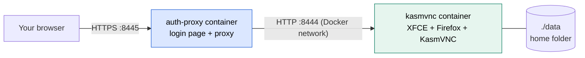
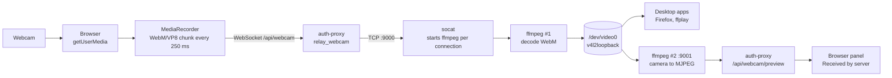
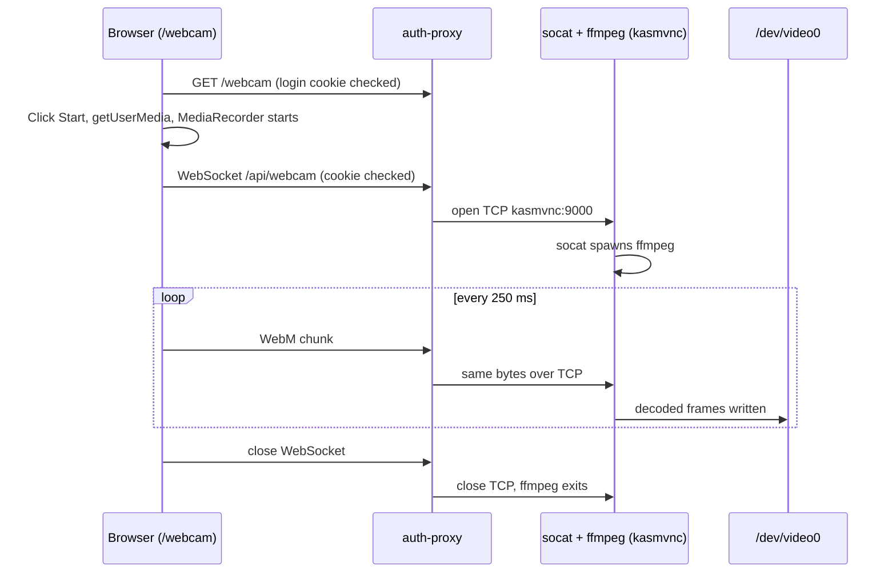
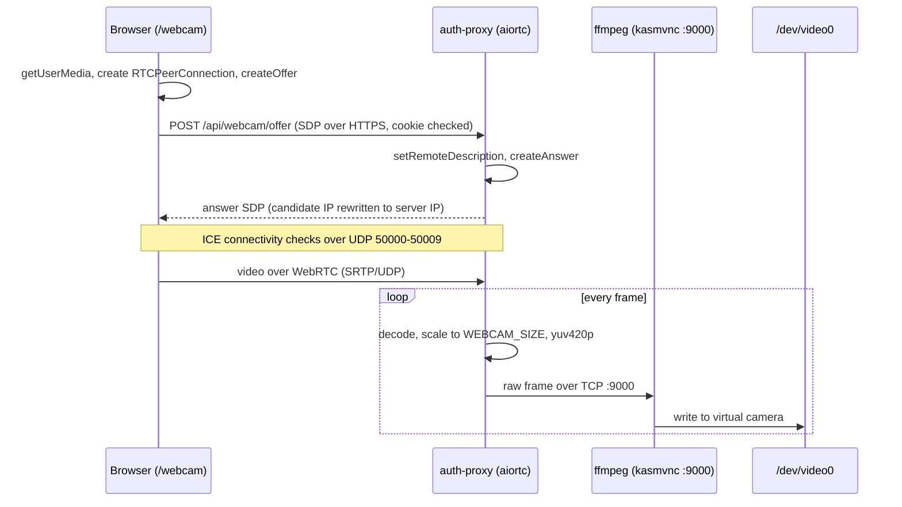
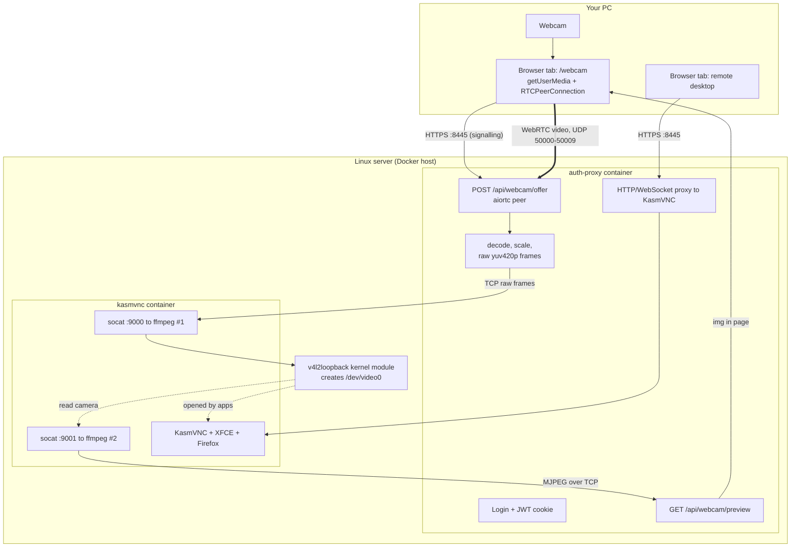

# Remote Desktop in Docker, with Webcam Passthrough

A Linux desktop (XFCE + Firefox) that you use from a web browser, protected by its own
login page, plus an experimental feature that streams **your local webcam into the
remote desktop** as a virtual camera.

This document records how the project got to its current state: what existed first,
the first webcam design, why it was replaced with WebRTC, every problem hit on the way,
and how to run and test it.

- [1. What the project is](#1-what-the-project-is)
- [2. Starting point (before the webcam work)](#2-starting-point-before-the-webcam-work)
- [3. The webcam problem](#3-the-webcam-problem)
- [4. Phase 1: WebSocket + MediaRecorder](#4-phase-1-websocket--mediarecorder)
- [5. Phase 2: switching to WebRTC](#5-phase-2-switching-to-webrtc)
- [6. Final architecture](#6-final-architecture)
- [7. File map](#7-file-map)
- [8. Setup and deployment](#8-setup-and-deployment)
- [9. Testing and verification](#9-testing-and-verification)
- [10. Problems hit and how each was fixed](#10-problems-hit-and-how-each-was-fixed)
- [11. Configuration reference](#11-configuration-reference)
- [12. Current status and known limits](#12-current-status-and-known-limits)
- [13. Security notes](#13-security-notes)

---

## 1. What the project is

Two Docker containers run by Docker Compose:

| Container | Built from | Job |
|---|---|---|
| `kasmvnc` | [Dockerfile](Dockerfile) | Ubuntu 22.04 with the XFCE desktop, Firefox and the KasmVNC server. Publishes **no ports**. |
| `auth-proxy` | [auth-proxy/](auth-proxy/) | The only externally reachable service. Serves a login page over HTTPS, then proxies everything to `kasmvnc`. Also hosts the webcam feature. |

`./data` on the host is mounted as the desktop user's home directory, so the Firefox
profile, files and settings persist across restarts.

---

## 2. Starting point (before the webcam work)

What was already built and working:

1. **A desktop in a container.** XFCE, Firefox (installed from Mozilla's tarball because
   Ubuntu 22.04's apt `firefox` is a snap stub that cannot run in a container), and
   **KasmVNC 1.5.0** as the VNC server with a built-in browser client. KasmVNC replaced an
   older Xvfb + x11vnc + noVNC stack, as noted in the Dockerfile.
2. **A custom login gate (`auth-proxy`).**
   - Python 3.12, FastAPI and uvicorn, serving HTTPS with a self-signed certificate.
   - React 18 (Vite) sign-in page, credentials from `AUTH_USERNAME` / `AUTH_PASSWORD`.
   - Session is a signed JWT in an httponly, secure cookie. The signing key is generated
     fresh at every start, so restarting the stack logs everyone out.
   - Catch-all HTTP and WebSocket proxy to KasmVNC, using `httpx` and `websockets`.
3. **Startup script** ([start.sh](start.sh)) that rewrites KasmVNC config into the
   mounted home folder each start, sets the VNC password, and starts `vncserver`.



Request path once logged in: the browser talks HTTPS to `auth-proxy`, which checks the
cookie and forwards HTTP and the `/websockify` WebSocket to `kasmvnc:8444`. Nothing
outside Docker can reach `kasmvnc` directly.

---

## 3. The webcam problem

**Goal:** use the webcam attached to the machine you are sitting at (USB or laptop
built-in) inside the remote desktop, for example in Firefox or a video app.

**Why VNC cannot do it:** VNC (the RFB protocol) sends screen pixels one way and
keyboard, mouse and clipboard the other way. It has no camera channel. Firefox inside the
container only sees devices that exist in the container, so `getUserMedia` finds none.
KasmVNC's built-in webcam passthrough belongs to Kasm's commercial Workspaces platform,
not the standalone server used here.

**The idea that solves it:** your local browser *can* read the webcam. Capture it there,
send it to the server, and present it inside the container as a fake camera device
(`/dev/video0`). Apps in the desktop then see an ordinary webcam.

The fake camera is created by **v4l2loopback**, a Linux kernel module that makes video
devices with no hardware behind them: whatever is written in can be read out by apps as
if it were a real camera. It has to be loaded on the Docker **host**, then passed into
the container.

---

## 4. Phase 1: WebSocket + MediaRecorder

The first working design. Simple to build and debug, but with high latency.



### Sequence of events



### Pieces added in this phase

| Piece | Role |
|---|---|
| `WebcamPage.jsx` | Camera page: local preview, Start/Stop, and a "Received by server" panel |
| `webcam.py` | `relay_webcam` copied WebSocket bytes to TCP; `stream_preview` streamed MJPEG back |
| `socat` in the kasmvnc container | Listens on TCP ports and launches one ffmpeg per connection |
| `ffmpeg` in the kasmvnc container | Decodes video and writes into `/dev/video0` |
| Port `9001` | Second ffmpeg reads the camera back out as MJPEG for the preview panel |

### Why it was replaced

WebM chunks over a WebSocket ride on TCP. TCP waits for lost packets, and the chunked
container adds buffering on both ends, so delay was clearly visible. Tuning helped
(chunks of 50 ms, 640x480, ffmpeg no-buffer flags), but chunked streaming over TCP
cannot get much below 300 to 500 ms. WebRTC exists for this case.

---

## 5. Phase 2: switching to WebRTC

**Decision:** move the browser-to-server transport to WebRTC, using **aiortc**
(a Python WebRTC library) inside `auth-proxy`. WebRTC sends media over UDP and drops
late frames instead of waiting for them, which is what makes video calls feel live.

### What changed

| Area | Phase 1 | Phase 2 |
|---|---|---|
| Browser | `MediaRecorder` + WebSocket | `RTCPeerConnection` (offer/answer) |
| Transport | TCP (WebSocket) | UDP (WebRTC media) |
| auth-proxy route | `WS /api/webcam` | `POST /api/webcam/offer` (signalling only) |
| auth-proxy work | Copy bytes | Decode with aiortc, scale, send **raw** frames |
| ffmpeg input | Decode WebM | Read raw `yuv420p` (nothing to decode) |
| Extra Docker config | none | Publish UDP `50000-50009` |

### Signalling and media



Only the small setup message goes through the normal HTTPS port, and it is protected by
the login cookie. The video itself flows browser to server directly over UDP.

### Design choices

- **Decode in auth-proxy, send raw frames to ffmpeg.** No second encode and decode
  cycle, so almost no extra delay. The cost is bandwidth on the internal Docker network
  (640x480 raw is about 14 MB/s at 30 fps), which is fine on one host.
- **Fixed frame size** (`WEBCAM_SIZE`, default `640x480`). Both containers read the same
  value: auth-proxy scales to it, ffmpeg is told to expect it.
- **Two Docker networking workarounds.** aiortc binds random UDP ports and advertises the
  container's internal IP. Neither works from outside Docker, so:
  1. `webcam.py` wraps the event loop's `create_datagram_endpoint` to keep aiortc inside
     the published range `50000-50009`. This needs the plain asyncio loop, so uvicorn is
     started with `--loop asyncio` (uvloop does not allow the wrapper).
  2. The candidate address in the answer SDP is rewritten to the address the browser
     used to reach the server (or `WEBCAM_PUBLIC_IP` if set).
- **No STUN servers.** Everything is on a private network. The default Google STUN
  server would stall ICE gathering on a machine without internet access.
- **One session at a time.** There is one virtual camera, so a new session replaces the
  previous one.

---

## 6. Final architecture



### What happens, click by click

1. **Open `/webcam`.** `auth-proxy` checks the login cookie and serves the same
   `index.html` as the login page. `main.jsx` picks `WebcamPage` from the URL.
2. **Click Start camera.** The browser asks for camera permission and shows the local
   video.
3. The page creates an `RTCPeerConnection`, gathers its network addresses, and POSTs the
   offer to `/api/webcam/offer`.
4. `auth-proxy` re-checks the cookie, creates an aiortc peer, and returns the answer with
   the server's reachable address.
5. **WebRTC connects.** ICE checks run over UDP `50000-50009`. Log line:
   `webcam: WebRTC connection connected`.
6. For every frame, `_pump_video` decodes, scales to `WEBCAM_SIZE`, converts to
   `yuv420p` and writes the bytes to `kasmvnc:9000` over TCP.
7. In `kasmvnc`, `socat` started one ffmpeg for that connection. It reads the raw frames
   and writes them to `/dev/video0`.
8. Any app in the desktop that opens `/dev/video0` now sees the webcam.
9. About 2 seconds after connecting, the page opens `/api/webcam/preview`. A second
   ffmpeg (port 9001) reads the virtual camera back out as MJPEG. This is the
   "Received by server" panel, proof that video reached the camera device.
10. **Stop or close the tab.** The peer connection closes, `stream ended after N frames`
    is logged, the TCP connection closes, and ffmpeg exits.

---

## 7. File map

| File | Purpose |
|---|---|
| [docker-compose.yml](docker-compose.yml) | Two services; maps `/dev/video0` into `kasmvnc`; publishes TCP `8445` and UDP `50000-50009` on `auth-proxy` |
| [Dockerfile](Dockerfile) | kasmvnc image; installs XFCE, KasmVNC, Firefox, `ffmpeg`, `socat`, `v4l-utils` |
| [start.sh](start.sh) | kasmvnc entrypoint: config, VNC password, `vncserver`, presets the camera format, starts the two `socat` listeners |
| [auth-proxy/Dockerfile](auth-proxy/Dockerfile) | Multi-stage: builds the React frontend, then the Python app |
| [auth-proxy/start.sh](auth-proxy/start.sh) | Makes the self-signed cert; runs uvicorn with `--loop asyncio` |
| [auth-proxy/requirements.txt](auth-proxy/requirements.txt) | Python deps, including `aiortc` and `numpy` |
| [auth-proxy/app/main.py](auth-proxy/app/main.py) | Routes: login, logout, `/webcam`, `/api/webcam/offer`, `/api/webcam/preview`, catch-all proxy |
| [auth-proxy/app/auth.py](auth-proxy/app/auth.py) | Credential check and JWT session cookie |
| [auth-proxy/app/proxy.py](auth-proxy/app/proxy.py) | HTTP and WebSocket proxy to KasmVNC |
| [auth-proxy/app/webcam.py](auth-proxy/app/webcam.py) | WebRTC offer handling, UDP port pinning, address rewrite, frame pump, MJPEG preview |
| [auth-proxy/frontend/src/WebcamPage.jsx](auth-proxy/frontend/src/WebcamPage.jsx) | Camera page (WebRTC client) |
| [auth-proxy/frontend/src/main.jsx](auth-proxy/frontend/src/main.jsx) | Picks login or webcam page by URL |

> **Careful:** there are two different `start.sh` files, one at the project root
> (kasmvnc) and one in `auth-proxy/`. Copying one over the other breaks the stack. This
> happened once (see section 10).

---

## 8. Setup and deployment

### 8.1 On the Docker host (one time)

The virtual camera must exist **before** `docker compose up`, or Docker refuses to start
`kasmvnc` (the compose file maps `/dev/video0`).

```bash
sudo apt update
sudo apt install -y v4l2loopback-dkms v4l2loopback-utils linux-headers-$(uname -r)
sudo modprobe v4l2loopback devices=1 video_nr=0 card_label="Virtual Cam" exclusive_caps=0
sudo chmod 666 /dev/video0          # let the container's user open it
ls -l /dev/video0
```

Make it survive reboots:

```bash
echo v4l2loopback | sudo tee /etc/modules-load.d/v4l2loopback.conf
echo 'options v4l2loopback devices=1 video_nr=0 card_label="Virtual Cam" exclusive_caps=0' \
  | sudo tee /etc/modprobe.d/v4l2loopback.conf
echo 'KERNEL=="video0", SUBSYSTEM=="video4linux", MODE="0666"' \
  | sudo tee /etc/udev/rules.d/99-v4l2loopback.rules
sudo udevadm control --reload-rules && sudo udevadm trigger
```

Open the firewall for WebRTC media (UDP) in addition to the HTTPS port:

```bash
sudo ufw allow 50000:50009/udp      # if you use ufw
sudo ufw allow 8445/tcp
```

> On a cloud/VPS kernel that does not allow loading modules, `modprobe` fails and the
> virtual camera cannot exist. Docker Desktop on Windows/macOS also lacks the module.

### 8.2 Configure and start

```bash
cp .env .env.bak                    # then edit .env: set real passwords
# .env needs: VNC_USERNAME, VNC_PASSWORD, AUTH_USERNAME, AUTH_PASSWORD
# optional:   KASM_PORT=8445   (compose default is now 8445)
sudo docker compose up -d --build
sudo docker compose ps
```

### 8.3 Use it

1. Open `https://<server-ip>:8445` and accept the self-signed certificate warning
   (once). Sign in. **Always use `https://`**; plain `http://` returns an empty page.
2. Open the desktop in one tab. In a second tab on the **same machine as the webcam**,
   open `https://<server-ip>:8445/webcam` and click **Start camera**.
3. In the remote desktop, open a webcam test page in Firefox, or run `ffplay /dev/video0`
   in the desktop terminal.

The camera page needs a secure context (HTTPS), which `auth-proxy` already provides.

---

## 9. Testing and verification

Test in stages from the server outward, so a failure points at exactly one link. Stages
1 to 3 need no webcam and no browser.

| Stage | Command (run on the server) | Pass means |
|---|---|---|
| 1. Virtual camera exists | `ls -l /dev/video0` and `v4l2-ctl --list-devices` | "Virtual Cam" is listed |
| 2. Container can write to it | `sudo docker exec kasmvnc ffmpeg -re -f lavfi -i testsrc=size=640x480:rate=30 -pix_fmt yuv420p -t 5 -f v4l2 /dev/video0` | Runs 5 s with no error |
| 3. A frame comes back out | While a stream or test is running: `sudo docker exec kasmvnc ffmpeg -y -loglevel error -f v4l2 -i /dev/video0 -frames:v 1 /tmp/snap.jpg && sudo docker exec kasmvnc ls -l /tmp/snap.jpg` | File is tens of KB |
| 4. Browser connects | Open `/webcam`, Start; then `sudo docker compose logs --tail 20 auth-proxy` | `WebRTC connection connected` |
| 5. Full chain | Watch the "Received by server" panel and a webcam test page in the remote Firefox | Both show live video |

**Checking each hop while streaming**

| Question | Command |
|---|---|
| Did the browser send? | Page status reads `streaming` |
| Did auth-proxy receive and decode? | `sudo docker compose logs -f auth-proxy` (states, and `stream ended after N frames`) |
| Is ffmpeg running and healthy? | `sudo docker exec kasmvnc ps aux \| grep '[f]fmpeg'` and `sudo docker logs --tail 20 kasmvnc` |
| Frame rate reaching the camera | `sudo docker exec kasmvnc ffmpeg -f v4l2 -i /dev/video0 -t 5 -f null - 2>&1 \| tail -3` |

Negative checks: logged out, `/webcam` redirects to `/login`; posting to
`/api/webcam/offer` without the cookie returns 401.

---

## 10. Problems hit and how each was fixed

In the order they occurred.

| # | Symptom | Cause | Fix |
|---|---|---|---|
| 1 | `docker compose up`: *error gathering device information ... /dev/video0: no such file* | The virtual camera did not exist on the host yet | Load `v4l2loopback` first (section 8.1) |
| 2 | `v4l2-ctl`: *Permission denied* on `/dev/video0` | Device created as `root:root`, mode `600` | `chmod 666` plus a udev rule |
| 3 | *Bind for 0.0.0.0:8444 failed: port is already allocated* | An older container from a previous project version (`vnc-desktop`) held the port | Moved to `KASM_PORT=8445`; the old container can be removed with `docker rm -f vnc-desktop` |
| 4 | Browser showed *empty response* | Visited `http://` but auth-proxy only speaks HTTPS | Use `https://` |
| 5 | Stream dropped, preview empty (Phase 1) | `socat` uses `:` as an address separator; the ffmpeg commands contained `pipe:0` and `-q:v`, so socat split them and refused to run | `-i -` and `-qscale`; keep colons out of `socat EXEC:` commands |
| 6 | Fix "did nothing" | The server had an old copy of `start.sh` | Copy the changed files to the server, then rebuild |
| 7 | Uncaught `RuntimeError` in the relay | Writing to a TCP connection the far end had already closed | Catch it and end the stream cleanly |
| 8 | Preview panel blank, ingest ffmpeg died | The preview reader opened the camera at the same moment as the writer | Open the preview about 2 s after streaming starts |
| 9 | WebRTC connected but `stream ended after 0 frames`; *No module named 'numpy'* | `VideoFrame.to_ndarray()` needs numpy; aiortc does not install it | Add `numpy==1.26.4` to `requirements.txt` |
| 10 | ffmpeg: *Unrecognized option 'fps_mode'* | Ubuntu 22.04's ffmpeg is 4.4; the flag is `-vsync` there | Use `-vsync passthrough` |
| 11 | `mkdir: cannot create directory '/etc/auth-proxy'` and `kasmvnc` restart loop; auth-proxy showed *Temporary failure in name resolution* | The two `start.sh` files were mixed up; kasmvnc was running auth-proxy's script | Restore the correct root `start.sh` |
| 12 | *Docker build error in requirements.txt* | Appending a line with `echo >>` to a file without a trailing newline glued two lines together | Rewrite the file so each requirement is on its own line |
| 13 | ffmpeg: *ioctl(VIDIOC_G_FMT): Invalid argument ... Could not write header*; reader: *Not a video capture device* | A fresh v4l2loopback device has no format yet, and ffmpeg's v4l2 output reads it first | Preset the format with `v4l2-ctl --set-fmt-video-out` in `start.sh` (fix added, see section 12) |

---

## 11. Configuration reference

**`.env`**

| Variable | Default | Meaning |
|---|---|---|
| `VNC_USERNAME`, `VNC_PASSWORD` | required | Internal KasmVNC login |
| `AUTH_USERNAME`, `AUTH_PASSWORD` | required | Sign-in page credentials |
| `KASM_PORT` | `8445` | Host port for HTTPS (maps to `8444` inside the container) |
| `BIND_ADDRESS` | `0.0.0.0` | Interface for published ports; use `127.0.0.1` behind an SSH tunnel |
| `DATA_DIR` | `./data` | Host folder mounted as the desktop home |
| `WEBCAM_SIZE` | `640x480` | Frame size; read by both containers |
| `WEBCAM_PUBLIC_IP` | unset | Address advertised for WebRTC media; needed only when you reach the server by hostname |

**Fixed values (change in code and compose together)**

| Value | Where |
|---|---|
| UDP range `50000-50009` | `docker-compose.yml`, `webcam.py` (`WEBCAM_ICE_PORT_MIN/MAX`) |
| TCP `9000` (ingest), `9001` (preview) | `start.sh`, `webcam.py` |
| Internal port `8444` | `auth-proxy/start.sh`, `docker-compose.yml`, `proxy.py` |

---

## 12. Current status and known limits

**Verified working (from server logs):**
- The login gate, desktop, and proxy.
- The WebRTC connection: `connecting`, then `connected`, over the published UDP range.
- Frames arrive and are decoded in auth-proxy (`stream ended after 3 frames` shows data
  flowed before the next stage failed).

**Last observed failure:** the ingest ffmpeg could not open `/dev/video0`
(`VIDIOC_G_FMT: Invalid argument`), so frames did not reach the virtual camera and the
"Received by server" panel stayed empty.

**Fix applied, not yet confirmed:** `start.sh` now presets the camera's format
(`v4l2-ctl --set-fmt-video-out`, YU12 at `WEBCAM_SIZE`) before the ffmpeg listeners
start. If it still fails, reset the module, then run the stage 2 test in section 9 to
tell a module problem from a code problem:

```bash
sudo docker compose stop kasmvnc
sudo modprobe -r v4l2loopback
sudo modprobe v4l2loopback devices=1 video_nr=0 card_label="Virtual Cam" exclusive_caps=0
sudo chmod 666 /dev/video0
sudo docker compose up -d
```

If stage 2 also fails with `G_FMT`, the cause is the v4l2loopback module version on the
server rather than this project's code.

**Known limits**
- One camera stream at a time; the `/webcam` tab must stay open.
- Video only; no microphone.
- Needs UDP `50000-50009` reachable from the client and a host kernel that can load
  `v4l2loopback`.
- Raw frames between containers use about 14 MB/s at 640x480 and 30 fps; larger
  `WEBCAM_SIZE` values cost more.
- The preview panel goes through an extra ffmpeg and MJPEG hop, so it may lag more than
  the real camera.

---

## 13. Security notes

- All access goes through `auth-proxy`, which checks the login cookie on the page, the
  signalling endpoint and the preview. `kasmvnc` publishes no ports.
- The HTTPS certificate is self-signed, so the browser shows a warning the first time.
- WebRTC media uses UDP ports that bypass the HTTPS port; only the signalling is behind
  the login cookie. Restrict `50000-50009/udp` to trusted networks in the firewall, or
  set `BIND_ADDRESS=127.0.0.1` and reach the server through an SSH tunnel.
- `chmod 666 /dev/video0` lets any local user on the server write to the camera; use
  `GROUP="video", MODE="0660"` in the udev rule if that matters.
- **`data/` holds sensitive material:** the Firefox profile (`logins.db`, `key4.db`),
  `.kasmpasswd`, `.vnc/passwd`, shell history and X auth files. Keep it out of any
  repository or shared archive, and keep `.env` (which holds passwords) out too.
