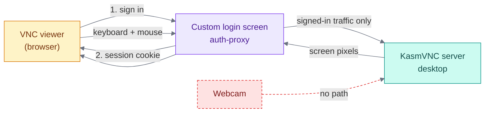
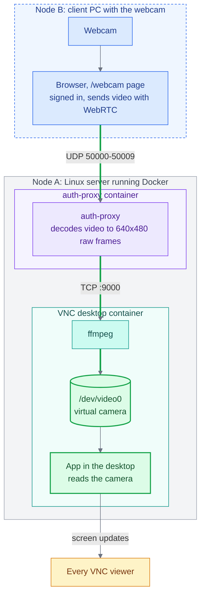
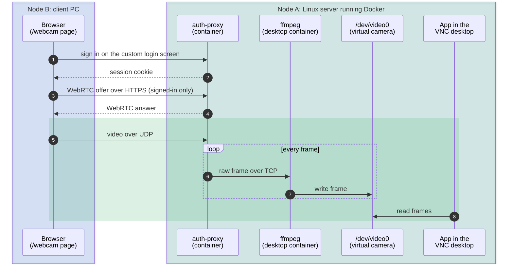

# VNC and Webcam Passthrough: Background

## 1. What VNC is

VNC lets you see and control another computer's desktop over a network. The server sends
**screen pixels**; the client sends **keyboard and mouse events**. Nothing else.

This project uses **KasmVNC**, which includes a web client, so the desktop opens in a
browser over HTTPS. It runs an XFCE desktop with Firefox in Docker. Several people can open
the same desktop at once.

**Custom login screen (POC).** For this proof of concept I designed my own sign-in screen
instead of using KasmVNC's built-in login. A small service called **auth-proxy** sits in
front of the desktop:

- It serves the custom login page, and checks the username and password.
- After a successful sign-in it issues a session cookie that ends when the browser closes.
- It forwards traffic to the desktop, and accepts the webcam stream, only for signed-in
  users.
- The KasmVNC desktop itself is not reachable from outside, so the login screen is the
  only way in.

---

## 2. Why video input is hard

- **VNC has no camera channel.** It only carries pixels out and input in.
- **The camera is on another machine.** The desktop runs in a container with no camera, and
  only the browser on that machine can read the webcam.
- **Apps need a real camera device.** On Linux that is `/dev/video0`, which a container
  cannot create. It comes from a kernel module (`v4l2loopback`) on the host.
- **Normal web transport is a poor fit for live video.** TCP and WebSocket stall on a lost
  packet, so video lags.
- **Network details.** Real-time media uses UDP, and the server's address inside Docker is
  not the one the browser can reach.
- **The webcam path must stay behind the login.** Only signed-in users may send video, so
  the WebRTC setup goes through the same custom login as the desktop.
- **One virtual camera**, so only one sender at a time.

---

## 3. How WebRTC solves it here

**WebRTC** is the browser's built-in way to send live video over UDP. A late packet is
dropped instead of blocking the rest, so video stays smooth.

The browser sends the webcam to the server with WebRTC. The server converts it into raw
frames and writes them into the virtual camera `/dev/video0`. Any app in the desktop that
reads a webcam can then open it as a normal camera.

**Two machines are involved:**

- **Node B** is the client PC. It has the webcam, and its browser sends the video.
- **Node A** is the Linux server that runs Docker. It hosts the VNC desktop and the
  auth-proxy login service, each in its own container.

### Flow chart

**Color key** (same in every diagram):
blue = client PC and browser · violet = auth-proxy and the login screen ·
teal = the VNC desktop and its processes · green = the virtual camera and the app that
reads it · amber = people viewing the desktop · red dashed = no path.

### Sequence diagram

---

## 4. Versions used

| Component | Version |
|---|---|
| Ubuntu (desktop container) | 22.04 |
| KasmVNC | 1.5.0 |
| Python (auth-proxy) | 3.12 |
| Node (frontend build) | 20 |
| aiortc (WebRTC) | 1.9.0 |
| FastAPI | 0.115.0 |
| Uvicorn | 0.30.6 |
| httpx | 0.27.2 |
| websockets | 13.1 |
| PyJWT | 2.9.0 |
| NumPy | 1.26.4 |
| React | ^18.3.1 |
| Vite | ^5.4.8 |
| ffmpeg | 4.4.2 |
| Docker (host) | 29.8.1 |
| Linux kernel (host) | 5.15.0-191 |

Firefox, XFCE, socat and the other system tools are not pinned. They install
the latest version available at build time.

---

## 5. Limits

- One sender at a time.
- The camera is readable only while the `/webcam` page is streaming.
- TCP 8445 and UDP 50000-50009 must be open between the two machines.
- `v4l2loopback` must be loaded with `exclusive_caps=0` on this server.
