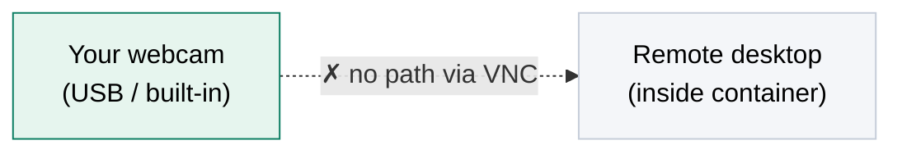
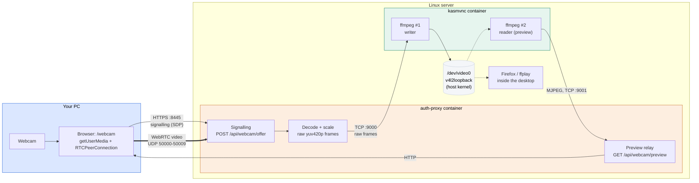
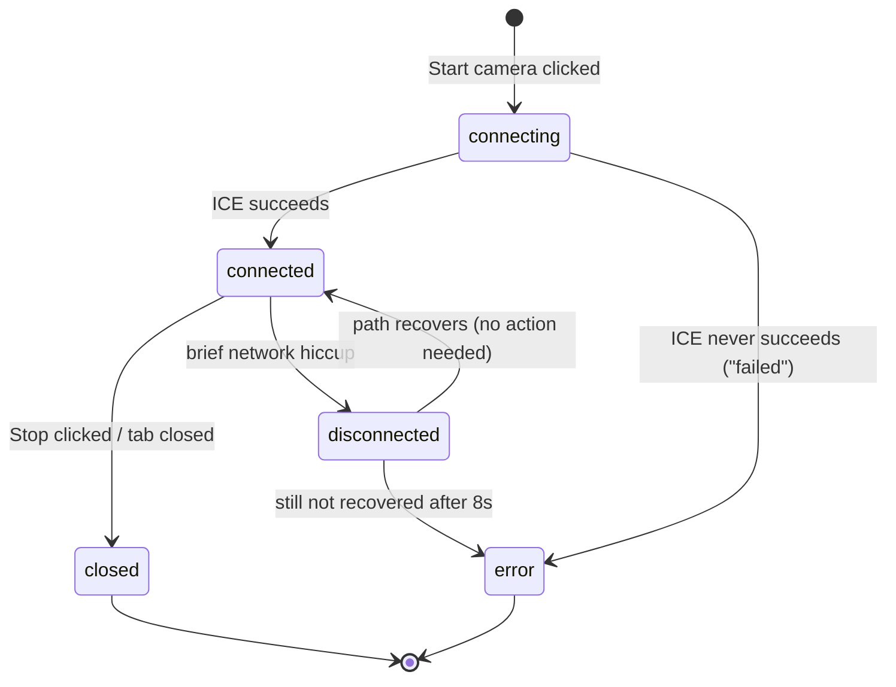

# Webcam over WebRTC — How It Works

A self-contained walkthrough of the webcam feature as it currently works (the WebRTC
phase). Meant to be readable on its own, with no prior context needed beyond: this
project runs a remote Linux desktop in Docker, behind a login page (`auth-proxy`), and
this feature lets your **local webcam** appear as a camera **inside** that remote
desktop.

- [1. The problem in one picture](#1-the-problem-in-one-picture)
- [2. The four things involved](#2-the-four-things-involved)
- [3. Full sequential flow](#3-full-sequential-flow)
- [4. Step-by-step, in plain words](#4-step-by-step-in-plain-words)
- [5. Architecture diagram](#5-architecture-diagram)
- [6. Connection states](#6-connection-states)
- [7. Why it's built this way](#7-why-its-built-this-way)
- [8. Where each step lives in the code](#8-where-each-step-lives-in-the-code)

---

## 1. The problem in one picture

VNC (the protocol powering the remote desktop) only ever sends screen pixels out and
keyboard/mouse in — it has no camera channel. So a webcam plugged into your PC is
invisible to anything running inside the container, unless we build a separate path for
it.



The fix: capture the camera in **your browser** (which *can* see it), send the video to
the server over **WebRTC**, and write it into a **fake camera device**
(`/dev/video0`, created by the `v4l2loopback` kernel module) inside the container. Any
app in the remote desktop that opens a webcam then sees this fake one, with your real
video playing through it.

---

## 2. The four things involved

| Piece | Runs where | Job |
|---|---|---|
| **Browser tab** (`/webcam` page) | Your PC | Reads the camera, sends video over WebRTC |
| **auth-proxy** | Server, in a container | Checks your login, negotiates the WebRTC connection, decodes incoming video |
| **kasmvnc container** | Server, in a container | Runs `ffmpeg` + `socat` to write decoded frames into the fake camera |
| **v4l2loopback** | Server, in the host kernel | Provides `/dev/video0`, the fake camera device itself |

---

## 3. Full sequential flow

Every numbered step below corresponds to the same numbers in the diagram.

```mermaid
flowchart TB
    subgraph PC["① YOUR PC"]
        direction TB
        P1(("1") ) --> P1T["Open /webcam<br/>(login cookie checked)"]
        P2(("2")) --> P2T["Click Start camera<br/>getUserMedia → local preview"]
        P3(("3")) --> P3T["Create RTCPeerConnection<br/>build an SDP offer"]
        P7(("7")) --> P7T["Apply the answer<br/>ICE checks begin over UDP"]
    end

    subgraph AP["② AUTH-PROXY CONTAINER"]
        direction TB
        P4(("4")) --> P4T["POST /api/webcam/offer<br/>cookie checked again"]
        P5(("5")) --> P5T["aiortc creates the answer<br/>rewrite candidate IP to server's real address"]
        P6(("6")) --> P6T["Return SDP answer<br/>over the same HTTPS request"]
        P9(("9")) --> P9T["For every video frame:<br/>decode → scale to WEBCAM_SIZE → yuv420p"]
        P10(("10")) --> P10T["Send raw frame bytes<br/>over TCP to kasmvnc:9000"]
    end

    subgraph KV["③ KASMVNC CONTAINER"]
        direction TB
        P11(("11")) --> P11T["socat hands the connection<br/>to ffmpeg #1"]
        P12(("12")) --> P12T["ffmpeg #1 writes frames<br/>into /dev/video0"]
    end

    subgraph V["④ VIRTUAL CAMERA"]
        direction TB
        V1["/dev/video0<br/>(v4l2loopback)"]
        V2["Desktop apps read it:<br/>Firefox, ffplay, etc."]
        V3["ffmpeg #2 (:9001) reads it back<br/>as MJPEG, for the preview panel"]
    end

    P1T --> P2T --> P3T -->|"HTTPS POST, offer SDP"| P4T
    P4T --> P5T --> P6T -->|"HTTPS response, answer SDP"| P7T
    P7T ==>|"WebRTC video, UDP 50000-50009"| P9T
    P9T --> P10T -->|"TCP :9000"| P11T --> P12T --> V1
    V1 --> V2
    V1 -.->|"read (after ~2s delay)"| V3
    V3 -->|"MJPEG over TCP :9001, then HTTP"| P6T
    P6T -.->|"/api/webcam/preview"| P1T

    style PC fill:#dbe7ff,stroke:#1f5fd6,color:#000
    style AP fill:#fdeee0,stroke:#c76a1f,color:#000
    style KV fill:#e6f5ee,stroke:#0b7d62,color:#000
    style V fill:#f4f6f9,stroke:#c5cdd9,color:#000
```

---

## 4. Step-by-step, in plain words

**Setup (once per session)**

1. **You open `/webcam`.** auth-proxy checks your login cookie before serving the page.
2. **You click "Start camera."** The browser's `getUserMedia` asks permission and hands
   the page a live video stream — this fills the "Your camera (local)" panel
   immediately, with nothing sent anywhere yet.
3. **The browser builds a WebRTC offer.** It creates an `RTCPeerConnection`, attaches
   the camera track, and calls `createOffer()`. This offer is just a text description
   (SDP) of what the browser can send and how to reach it — no video yet.
4. **The offer is POSTed to the server.** A plain HTTPS request to
   `/api/webcam/offer`, which auth-proxy checks against your login cookie exactly like
   any other route.
5. **The server builds its answer.** Using the `aiortc` Python library, auth-proxy reads
   the offer, decides how it will receive the video, and creates an SDP answer of its
   own. It also rewrites the network address inside that answer — see
   [section 7](#7-why-its-built-this-way) for why that's needed.
6. **The answer comes back** in the same HTTP response — the signalling exchange is
   done in a single request/response, not an open connection.
7. **The browser applies the answer.** Now both sides know how to reach each other, and
   WebRTC's ICE process runs a quick connectivity check directly over UDP.

**Streaming (continuously, while connected)**

8. Once ICE succeeds, the connection state becomes `connected` and the video track
   starts flowing from the browser to auth-proxy, entirely over **UDP**, bypassing the
   HTTPS port completely.
9. **auth-proxy decodes each incoming frame**, scales it to a fixed size
   (`WEBCAM_SIZE`, default 640×480), and converts it to raw `yuv420p` pixels.
10. Those raw bytes are sent over a plain **TCP** connection to the kasmvnc container,
    port 9000.
11. In kasmvnc, `socat` is listening on port 9000. The moment the connection opens, it
    starts one `ffmpeg` process dedicated to that connection.
12. That `ffmpeg` writes every frame it receives straight into **`/dev/video0`**, the
    fake camera device.

**Consuming the video**

- Anything inside the remote desktop that opens a webcam — Firefox, `ffplay`, a video
  call app — now reads your real, live video through this fake device.
- About 2 seconds after the connection is established, the `/webcam` page also opens a
  **preview** of what the server actually received: a second `ffmpeg` (port 9001) reads
  `/dev/video0` back out as a stream of JPEG images (MJPEG), which auth-proxy relays to
  the "Received by server" panel. This exists purely so you can visually confirm the
  video made the whole round trip, without needing to open the remote desktop.

**Ending**

- Clicking **Stop**, closing the tab, or losing the connection closes the
  `RTCPeerConnection`. auth-proxy's frame loop then ends, closes the TCP connection to
  port 9000, `ffmpeg` exits, and `/dev/video0` goes idle until the next session.

---

## 5. Architecture diagram



---

## 6. Connection states

The page tracks `RTCPeerConnection.connectionState` and reacts differently to each
value — this matters because WebRTC connections can wobble briefly without actually
dying.



- **`connecting`** — offer sent, waiting for the answer and ICE checks.
- **`connected`** — video is flowing. The page shows "streaming" and opens the preview
  panel after a short delay.
- **`disconnected`** — the path was interrupted (packet loss, Wi-Fi blip, NAT
  rebinding). This is often **temporary**: the page shows "reconnecting" and waits up to
  8 seconds to see if it recovers on its own before giving up.
- **`failed`** — ICE could not establish a path at all (usually a blocked UDP port).
- **`closed`** — the connection was deliberately ended.

---

## 7. Why it's built this way

**Why WebRTC instead of just sending video over a WebSocket?**
WebRTC sends media over UDP and simply drops a late frame instead of waiting for it,
which is what keeps video feeling live (typically well under 150 ms delay). A
WebSocket rides on TCP, which insists on retransmitting anything lost — fine for text,
but it makes video feel laggy under any packet loss. An earlier version of this feature
used exactly that (WebSocket + chunked recording) and reliably ran 300–500 ms behind.

**Why no STUN/TURN servers (`iceServers: []`)?**
STUN/TURN exist to help two peers find each other across the public internet, through
NATs they don't control. Here, the browser and the server are on the same local
network and can reach each other directly — adding a public STUN server would only add
a dependency on internet access the server may not have, and could stall connection
setup for no benefit.

**Why does auth-proxy rewrite the answer's IP address?**
`aiortc` by default advertises the container's own internal Docker IP (something like
`172.18.0.x`) as where it can be reached. Machines outside Docker can't route to that
address at all — it's exactly the same class of mistake as trying to open
`https://172.18.0.1:8445` from another machine (see the project's SETUP.md
troubleshooting table). So before sending the answer, auth-proxy swaps that internal
address for the address you actually used to reach the server.

**Why pin aiortc to a fixed UDP port range?**
By default, WebRTC libraries bind to random high UDP ports. Docker can only forward
ports that are explicitly published in `docker-compose.yml`, so a random port would
usually not be reachable from outside. auth-proxy wraps the event loop's socket-creation
function to force aiortc into the fixed range `50000-50009`, which is the same range
`docker-compose.yml` publishes.

**Why decode in auth-proxy and send raw frames, instead of forwarding the encoded
video straight to ffmpeg?**
Decoding needs to happen somewhere — either once in `auth-proxy` (via `aiortc`/PyAV,
which already decoded the incoming WebRTC stream to get usable frames), or a second time
in `ffmpeg`. Since `aiortc` hands us decoded frames anyway, forwarding raw pixel data
avoids re-encoding and re-decoding the same video twice, which would add both delay and
CPU cost for no benefit.

**Why present a "Received by server" preview at all?**
Without it, the only way to confirm video actually made it into `/dev/video0` was to
open the full remote desktop and manually launch something. The preview closes that
loop directly on the `/webcam` page, which is what made it possible to isolate and fix
several bugs during development (see README.md section 10) without needing two browser
tabs open at once.

---

## 8. Where each step lives in the code

| Step | File | What to look at |
|---|---|---|
| 1–3, 7 | `auth-proxy/frontend/src/WebcamPage.jsx` | `startCamera()`, `waitForIceGathering()` |
| 4 | `auth-proxy/app/main.py` | `POST /api/webcam/offer` route |
| 5–6 | `auth-proxy/app/webcam.py` | `handle_offer()`, `_advertise_address()` |
| 8 | `auth-proxy/app/webcam.py` | `_restrict_udp_ports()` |
| 9–10 | `auth-proxy/app/webcam.py` | `_pump_video()` |
| 11–12 | `start.sh` (project root) | the `socat TCP-LISTEN:9000 ...` line |
| Preview | `start.sh`, `auth-proxy/app/webcam.py`, `WebcamPage.jsx` | the `:9001` listener, `stream_preview()`, the "Received by server" panel |
| Connection-state handling | `auth-proxy/frontend/src/WebcamPage.jsx` | `pc.onconnectionstatechange` |

For the full history of how this design was reached (including the earlier
WebSocket-based version and every bug fixed along the way), see
[README.md](README.md). For how to actually stand the whole project up on a server, see
[SETUP.md](SETUP.md).
